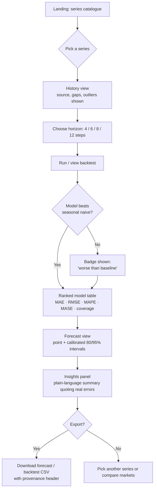
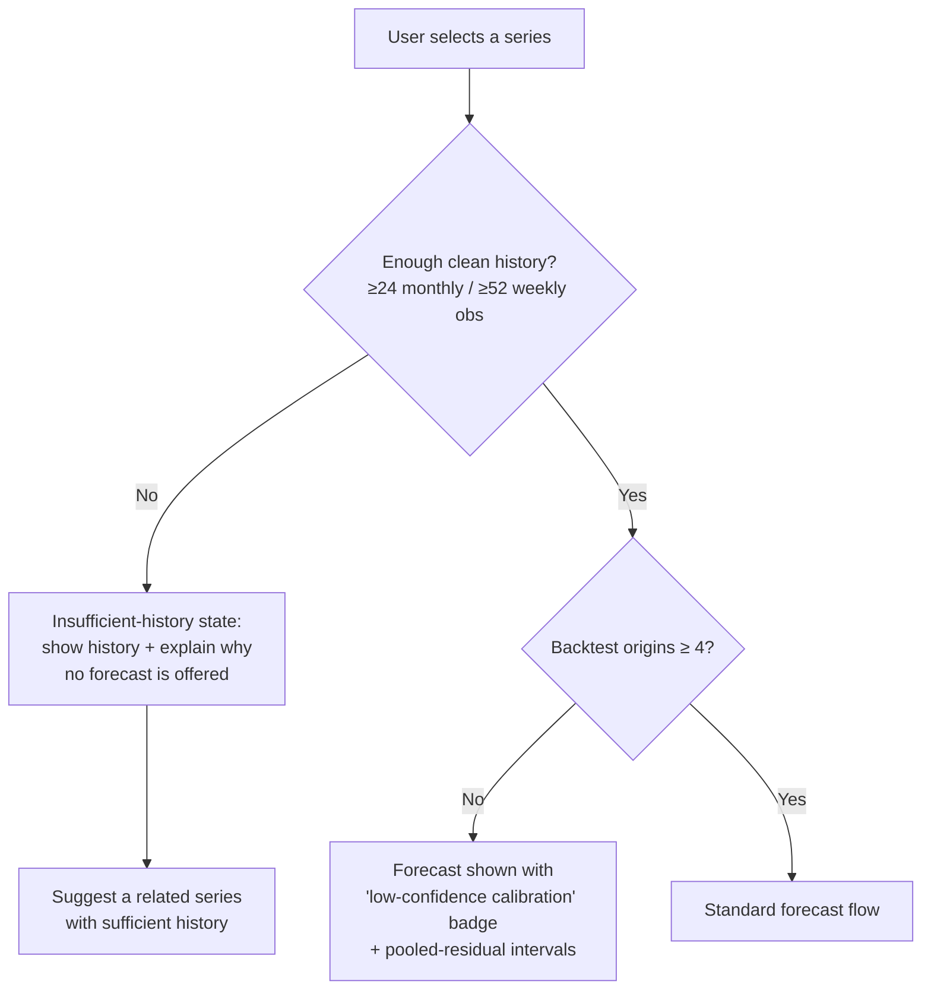
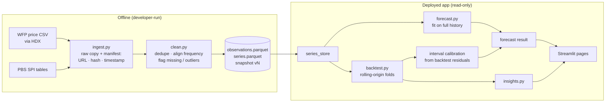
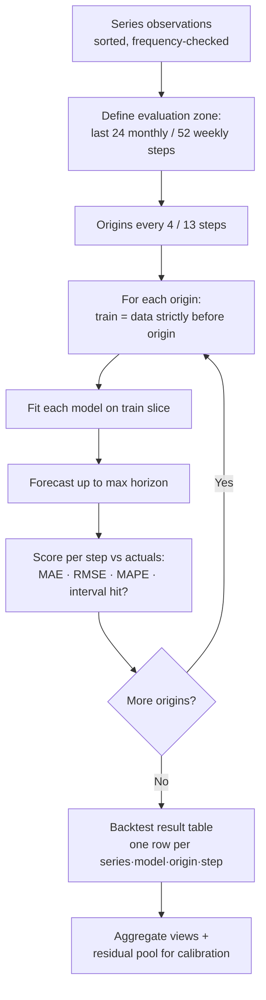
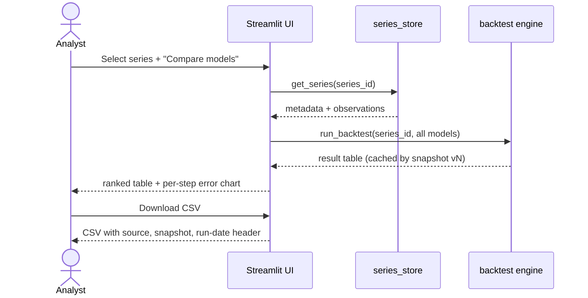

# FLOW — TrendCast User & Data Flows

## 1. Primary user flow: "Should I trust this forecast?"

## 2. Guard flow: insufficient or unreliable data

## 3. Data flow: source → snapshot → screen

## 4. Backtest fold flow (per series)

**Leakage invariant (tested):** the only place an origin slices the series is `backtest.py`; a unit test inserts an extreme sentinel value after an origin and asserts that origin's metrics are unchanged.

## 5. Analyst flow: comparing models for a briefing

## 6. Refresh flow (stretch, FR-14)

Developer re-runs ingestion → new snapshot committed → app redeploys → footer "Data as of" updates → cached backtests invalidate automatically because the cache key includes the snapshot version.
